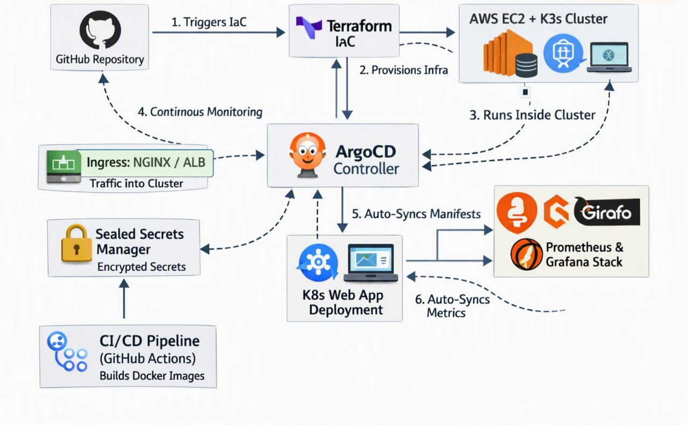

# End-to-End GitOps & Observability Stack on AWS

## 📖 Overview
A fully automated deployment pipeline demonstrating Infrastructure-as-Code (Terraform), GitOps (ArgoCD), Lightweight Kubernetes (K3s), and Observability (Prometheus & Grafana) on AWS.

## 🏗️ Architecture

*   **Provisioning:** Terraform provisions an AWS EC2 instance and Security Groups.
*   **Orchestration:** K3s is automatically bootstrapped via cloud-init/user_data.
*   **GitOps:** ArgoCD continuously monitors this repo and syncs manifests to the cluster.
*   **Observability:** Prometheus scrapes metrics, and Grafana provides visual dashboards.

## 📂 Repository Structure
- `terraform/` - AWS infrastructure definitions.
- `k8s/` - Kubernetes manifests for the demo application.
- `monitoring/` - Prometheus & Grafana stack configurations.
- `argocd/` - ArgoCD Application manifests.
- `.github/` - For Continuous integration
- `Makefile/` - For standard automation interface

## 🚀 Prerequisites
- AWS CLI configured with appropriate IAM permissions.
- Terraform installed (v1.5+).
- Kubectl installed.
- Git.

## 🛠️ How to Deploy
1. **Clone the repo:**

   git clone https://github.com/Sipkaverma/gitops-terraform-k8s-architecture.git
   cd gitops-terraform-k8s-architecture
